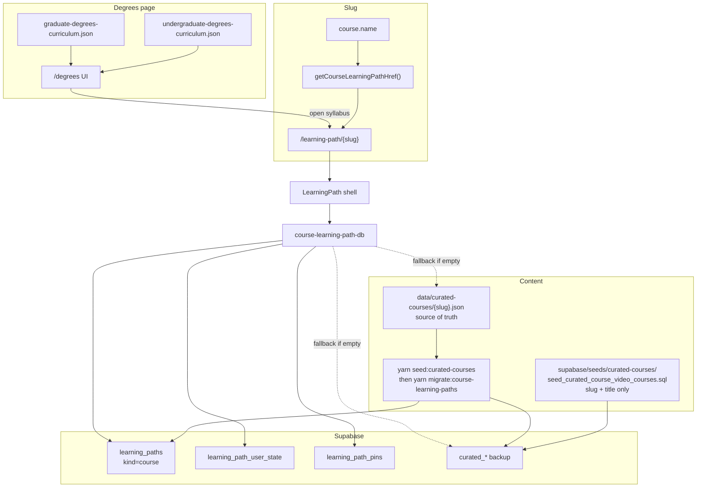
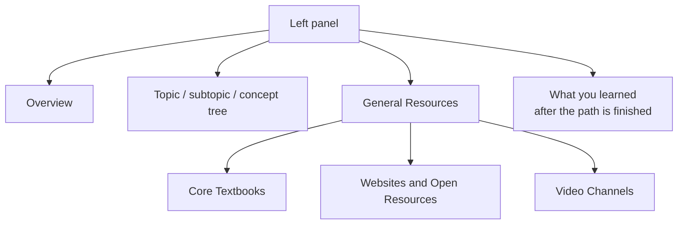

# Course learning paths (curated syllabi)

Degree syllabi with a topic tree and sequenced resources. They live on the same `learning_paths` table as community/research paths (`kind = course`) and share `/paths/learning-path/{slug}`. See [learning-paths.md](./learning-paths.md) for the graph UI.

**Official Notion courses stay on `/course/{pageId}`.** They are not `kind = course` rows. A later pass will migrate those professor courses onto `learning_paths` too so every Coursetexts course is a learning path. That work is not started — see [architecture — Future](./architecture.md#future-official-notion-courses).

**Canonical route:** `/paths/learning-path/{slug}`

Migrated rows: `kind = 'course'`, `visibility = 'public'`, `is_catalog = true`, `owner_id = null`. `curated_*` tables are **not dropped**; they remain a backup. The app reads/writes `learning_paths.data` after cutover.

## End-to-end flow



## Tables (live vs backup)

| Table | Role after unify |
|-------|------------------|
| `learning_paths` (`kind=course`) | Identity + syllabus JSON (`data`) |
| `learning_path_user_state` | Per-user TipTap notes keyed by node id |
| `learning_path_pins` | Per-user pinned syllabi (header dropdown). Hover a row for explored/total + **Continue →** to the next node (`?node=`). |
| `curated_courses` / `curated_course_*` | Backup + migrate/seed source; app does not write these after cutover |

Resources added on a syllabus node also appear in `/community-resources`. They are labeled with a plain-text **topic tree** such as `Linear Algebra --> Linear Systems and Elimination --> Gaussian elimination and row reduction`.

Comments/bookmarks on the page keep `courses.notion_page_id = 'course-learning-path:{slug}'` so existing threads stay attached.

Empty catalog placeholders (~1800 slug+title rows) become `kind=course` catalog paths with empty `topics` and `is_filled = false`. Paths home lists filled syllabi in the shared **Try learning paths built by our community** grid (with goal-based and research cards), each labeled **Academic course**, and does **not** list the empty stubs. Official Notion university courses are on the Coursetexts home and `/all-courses`, not that Paths home section. The **Academic** view of `/paths/all-paths` (`?view=academic`) lists filled syllabi only (no official Notion courses): every `data/curated-courses/{slug}.json` that has a topic tree, plus any extra `learning_paths` rows with `is_filled`. Science / Math / Sociology / English filter that grid and the degree list under it. All-view search (`?view=all`) can still rank a matching syllabus with the other learning paths (no section heading). A teal promo in that syllabus grid links to `/paths/degrees`. Old `/paths/all-courses?view=courses` redirects to `?view=academic`. A trigger keeps `is_filled` in sync when `data` changes. Existing DBs: apply `029_learning_path_is_filled.sql`. The **Goal-based** catalog filter does **not** list these syllabi (see [learning-paths.md](./learning-paths.md)). The profile Paths tab **Academic** filter uses the same split: official Notion bookmarks plus `kind=course` paths. Finishing every syllabus topic records Knowledge labels, shows the completion modal, and adds **What you learned** under Resources in the left nav. See [knowledge.md](./knowledge.md).

Subject icons on those cards reuse the degrees-page SVG set (`DegreeCardIcon`). Area is **not** a Supabase column: optional JSON `"area": "mathematics"` (a degree id) overrides slug-based keywords. The Coursetexts book mark stays on the card; the colored icon is the subject.

## Left-nav page sections



- **Overview** — same tab as community paths (`?node=syllabus:overview`; `mental-map` and `overview` canonicalize here). Course title, then **Introductory Resources** (`data.mentalMapNodeId` holds map-only clips), then **Recommended Path** topic list. No type badges and no **Why is this on the learning path** (the course blurb stays in the hero). A 1px hairline sits under this row (none above it). Searching for “overview”, “general approach”, “mental map”, or “recommended syllabus” still finds **Overview**. **Commit & Remind Me** sits on the bottom step bar next to **Start learning path** (first topic, or the first General Resources section when there are no topics yet; `learning-path:{slug}`).
- **Topic tree** — accordion topics with a vertical line for nested lectures. A light-blue stroke check appears on the right when a topic or lecture is explored. Loads that node’s sequenced resources from `learning_paths.data`. **Why is this on the learning path:** is inline under the title. **Resources** start open.
- **General Resources** — left-nav tab under Overview (`?node=resources`). One numbered list per section (**Core Textbooks**, **Websites and Open Resources**, **Video Channels**). Degrees-page curriculum rows (`data.resources` or undergraduate/graduate JSON fallback) are **migrated at render time** into the same topic-resource card shape as the rest of the path: stable `curated:{kind}:{index}:{slug}` ids, section order preserved, `description` (and non-URL publisher text) → passage (“The part that helped and why”). Learner-added cards from `data.generalResourceTopicResources` follow the curated list. Cards support vote / bookmark / report / info toggle like other path resources; curated rows are not editable. Helpers live in `lib/course-learning-path-resources.ts` (`courseCurriculumResourcesToTopicResources`, `mergeGeneralResourceTopicLists`).
- **What you learned** — appears only after every syllabus node is explored.
- **Ratings** — marking a topic explored asks how long it took and a % for how enjoyable learning that module was using the given resources; finishing the course asks the same for the whole course.

Notes open from the content bar (side panel), not an in-page dropdown. On mobile, the syllabus outline is a left drawer (**The Path** in the topic bar). In the notes side panel, **Export PDF** is under the toolbar **…** menu.

## JSON shape

See [`data/curated-courses/README.md`](../data/curated-courses/README.md).

```text
{slug}.json
  slug, title, description
  resources[]     kind: textbook | website | youtube
                  (General Resources: migrated at render into topic-resource
                  cards; description → passage)
  generalResourceTopicResources?  learner-added General Resources cards
                  keyed by textbook | website | youtube
  topics[]        type: topic → subtopic → concept
    videos[]      ordered clips (seeded into videos, then node_resources)
```

## Filling another course

1. Add `data/curated-courses/{slug}.json` (copy Fluid Mechanics).
2. Ensure a catalog row exists in `curated_courses` (degrees catalog seed covers most names).
3. Load the tree:
   - **SQL Editor:** `supabase/seeds/curated-courses/seed_fluid_mechanics_curated_course.sql` is the template, or
   - `yarn seed:curated-courses -- --slug={slug}` (writes `curated_*` then upserts `learning_paths`).
4. Open `/learning-path/{slug}`.

## SQL seeds folder

All curated-course SQL seeds live in [`supabase/seeds/curated-courses/`](../supabase/seeds/curated-courses/).

| File | Contents |
|------|----------|
| `seed_curated_course_video_courses.sql` | Catalog rows (slug + title) for degrees courses |
| `seed_fluid_mechanics_curated_course.sql` | Full Fluid Mechanics tree + videos + resources (self-contained schema repair) |
| `seed_deep_learning_curated_course.sql` | Deep Learning syllabus tree |
| `seed_data_structures_curated_course.sql` | Data Structures syllabus tree |
| `seed_algorithms_curated_course.sql` | Algorithms syllabus tree |
| `seed_database_systems_curated_course.sql` | Database Systems syllabus tree |
| `seed_operating_systems_curated_course.sql` | Operating Systems syllabus tree |
| `seed_computer_networks_curated_course.sql` | Computer Networks syllabus tree + resources |
| `seed_programming_languages_curated_course.sql` | Programming Languages syllabus tree |
| `seed_computer_organization_architecture_curated_course.sql` | Computer Organization/Architecture syllabus tree |
| `seed_computer_organization_and_architecture_curated_course.sql` | Computer Organization and Architecture syllabus tree |
| `seed_linear_algebra_curated_course.sql` | Linear Algebra syllabus tree |
| `seed_calculus_i_curated_course.sql` | Calculus I syllabus tree + resources |
| `seed_calculus_ii_curated_course.sql` | Calculus II syllabus tree + resources |
| `seed_calculus_iii_multivariable_curated_course.sql` | Calculus III (Multivariable) syllabus tree + resources |
| `seed_differential_equations_curated_course.sql` | Differential Equations syllabus tree + resources |
| `seed_financial_accounting_curated_course.sql` | Financial Accounting syllabus tree + resources |
| `seed_business_statistics_curated_course.sql` | Business Statistics syllabus tree + resources |
| `seed_corporate_finance_curated_course.sql` | Corporate Finance syllabus tree + resources |
| `seed_microeconomics_curated_course.sql` | Microeconomics syllabus tree + resources |
| `seed_anatomy_and_physiology_i_curated_course.sql` | Anatomy and Physiology I syllabus tree |
| `seed_anatomy_and_physiology_ii_curated_course.sql` | Anatomy and Physiology II syllabus tree (also upserts `learning_paths`) |
| `seed_probability_and_statistics_curated_course.sql` | Probability and Statistics syllabus tree |
| `seed_computer_systems_systems_programming_curated_course.sql` | Computer Systems / Systems Programming syllabus tree |
| `seed_introduction_to_programming_curated_course.sql` | Introduction to Programming syllabus tree |
| `seed_theory_of_computation_curated_course.sql` | Theory of Computation syllabus tree |
| `seed_compilers_curated_course.sql` | Compilers syllabus tree |
| `seed_artificial_intelligence_machine_learning_curated_course.sql` | Artificial Intelligence / Machine Learning syllabus tree |
| `seed_introductory_physics_i_mechanics_curated_course.sql` | Introductory Physics I (Mechanics) syllabus tree |
| `seed_introductory_physics_ii_eandm_curated_course.sql` | Introductory Physics II (E&M) syllabus tree |
| `seed_modern_physics_curated_course.sql` | Modern Physics syllabus tree |
| `seed_mathematical_methods_for_physics_curated_course.sql` | Mathematical Methods for Physics syllabus tree |
| `seed_classical_mechanics_curated_course.sql` | Classical Mechanics syllabus tree |
| `seed_electromagnetism_electrodynamics_curated_course.sql` | Electromagnetism / Electrodynamics syllabus tree |
| `seed_quantum_mechanics_i_curated_course.sql` | Quantum Mechanics I syllabus tree |
| `seed_thermodynamics_and_statistical_mechanics_curated_course.sql` | Thermodynamics and Statistical Mechanics syllabus tree |
| `seed_quantum_mechanics_ii_curated_course.sql` | Quantum Mechanics II syllabus tree |
| `seed_optics_curated_course.sql` | Optics syllabus tree |
| `seed_solid_state_condensed_matter_physics_curated_course.sql` | Solid State / Condensed Matter Physics syllabus tree |
| `seed_introduction_to_proofs_foundations_curated_course.sql` | Introduction to Proofs / Foundations syllabus tree |
| `seed_probability_theory_curated_course.sql` | Probability Theory syllabus tree |
| `seed_abstract_algebra_curated_course.sql` | Abstract Algebra syllabus tree |
| `seed_real_analysis_curated_course.sql` | Real Analysis syllabus tree (also upserts `learning_paths`) |
| `seed_differential_geometry_curated_course.sql` | Differential Geometry syllabus tree |
| `seed_number_theory_curated_course.sql` | Number Theory syllabus tree |
| `seed_mathematical_statistics_curated_course.sql` | Mathematical Statistics syllabus tree |
| `seed_numerical_analysis_curated_course.sql` | Numerical Analysis syllabus tree |
| `seed_complex_analysis_curated_course.sql` | Complex Analysis syllabus tree |
| `seed_topology_curated_course.sql` | Topology syllabus tree |
| `seed_organic_chemistry_i_curated_course.sql` | Organic Chemistry I syllabus tree |
| `seed_organic_chemistry_ii_curated_course.sql` | Organic Chemistry II syllabus tree |
| `seed_analytical_chemistry_curated_course.sql` | Analytical Chemistry syllabus tree |
| `seed_physical_chemistry_i_thermodynamics_and_statistical_mechanics_curated_course.sql` | Physical Chemistry I (Thermodynamics & Statistical Mechanics) syllabus tree |
| `seed_physical_chemistry_ii_quantum_mechanics_and_spectroscopy_curated_course.sql` | Physical Chemistry II (Quantum Mechanics & Spectroscopy) syllabus tree |
| `seed_inorganic_chemistry_curated_course.sql` | Inorganic Chemistry syllabus tree |
| `seed_instrumental_analysis_curated_course.sql` | Instrumental Analysis syllabus tree |
| `seed_biochemistry_curated_course.sql` | Biochemistry syllabus tree + resources |
| `seed_dynamics_curated_course.sql` | Dynamics syllabus tree + resources |
| `seed_statics_curated_course.sql` | Statics syllabus tree + resources |
| `seed_general_biology_i_curated_course.sql` | General Biology I syllabus tree |
| `seed_general_biology_ii_curated_course.sql` | General Biology II syllabus tree |
| `seed_general_biology_i_and_ii_curated_course.sql` | General Biology I & II syllabus tree |
| `seed_general_biology_curated_course.sql` | General Biology syllabus tree |
| `seed_introduction_to_biomedical_engineering_curated_course.sql` | Introduction to Biomedical Engineering syllabus tree |
| `seed_physics_i_curated_course.sql` | Physics I syllabus tree |
| `seed_physics_i_mechanics_curated_course.sql` | Physics I (Mechanics) syllabus tree + resources |
| `seed_physics_ii_curated_course.sql` | Physics II syllabus tree |
| `seed_physics_ii_eandm_curated_course.sql` | Physics II (E&M) syllabus tree + resources |
| `seed_genetics_curated_course.sql` | Genetics syllabus tree |
| `seed_cell_and_molecular_biology_curated_course.sql` | Cell and Molecular Biology syllabus tree |
| `seed_ecology_curated_course.sql` | Ecology syllabus tree |
| `seed_evolutionary_biology_curated_course.sql` | Evolutionary Biology syllabus tree |
| `seed_microbiology_curated_course.sql` | Microbiology syllabus tree |
| `seed_physiology_anatomy_and_physiology_curated_course.sql` | Physiology / Anatomy and Physiology syllabus tree |
| `seed_biostatistics_curated_course.sql` | Biostatistics syllabus tree + resources |
| `seed_statistics_biostatistics_curated_course.sql` | Statistics / Biostatistics syllabus tree |
| `seed_general_chemistry_curated_course.sql` | General Chemistry syllabus tree |
| `seed_chemistry_for_health_sciences_curated_course.sql` | Chemistry for Health Sciences syllabus tree (also upserts `learning_paths`) |
| `seed_nutrition_curated_course.sql` | Nutrition syllabus tree (also upserts `learning_paths`) |
| `seed_statistics_for_health_sciences_curated_course.sql` | Statistics for Health Sciences syllabus tree (also upserts `learning_paths`) |
| `seed_pathophysiology_curated_course.sql` | Pathophysiology syllabus tree (also upserts `learning_paths`) |
| `seed_genetics_and_genomics_for_nursing_curated_course.sql` | Genetics and Genomics for Nursing syllabus tree (also upserts `learning_paths`) |
| `seed_pharmacology_curated_course.sql` | Pharmacology syllabus tree (also upserts `learning_paths`) |
| `seed_health_assessment_curated_course.sql` | Health Assessment syllabus tree (also upserts `learning_paths`) |
| `seed_fundamentals_of_nursing_curated_course.sql` | Fundamentals of Nursing syllabus tree (also upserts `learning_paths`) |
| `seed_medical_surgical_nursing_i_curated_course.sql` | Medical-Surgical Nursing I syllabus tree (also upserts `learning_paths`) |
| `seed_medical_surgical_nursing_ii_curated_course.sql` | Medical-Surgical Nursing II syllabus tree (also upserts `learning_paths`) |
| `seed_maternal_newborn_nursing_curated_course.sql` | Maternal-Newborn Nursing syllabus tree (also upserts `learning_paths`) |
| `seed_pediatric_nursing_curated_course.sql` | Pediatric Nursing syllabus tree (also upserts `learning_paths`) |
| `seed_mental_health_nursing_curated_course.sql` | Mental Health Nursing syllabus tree (also upserts `learning_paths`) |
| `seed_gerontological_nursing_curated_course.sql` | Gerontological Nursing syllabus tree (also upserts `learning_paths`) |
| `seed_nursing_informatics_healthcare_technology_curated_course.sql` | Nursing Informatics / Healthcare Technology syllabus tree (also upserts `learning_paths`) |
| `seed_nursing_research_and_evidence_based_practice_curated_course.sql` | Nursing Research and Evidence-Based Practice syllabus tree (also upserts `learning_paths`) |
| `seed_community_public_health_nursing_curated_course.sql` | Community/Public Health Nursing syllabus tree (also upserts `learning_paths`) |
| `seed_nursing_leadership_and_management_curated_course.sql` | Nursing Leadership and Management syllabus tree (also upserts `learning_paths`) |
| `seed_introduction_to_health_professions_curated_course.sql` | Introduction to Health Professions syllabus tree (also upserts `learning_paths`) |
| `seed_medical_terminology_curated_course.sql` | Medical Terminology syllabus tree (also upserts `learning_paths`) |
| `seed_introductory_psychology_curated_course.sql` | Introductory Psychology syllabus tree (also upserts `learning_paths`) |
| `seed_introduction_to_public_health_curated_course.sql` | Introduction to Public Health syllabus tree (also upserts `learning_paths`) |
| `seed_healthcare_systems_and_policy_curated_course.sql` | Healthcare Systems and Policy syllabus tree (also upserts `learning_paths`) |
| `seed_nutrition_and_wellness_curated_course.sql` | Nutrition and Wellness syllabus tree (also upserts `learning_paths`) |
| `seed_epidemiology_curated_course.sql` | Epidemiology syllabus tree (also upserts `learning_paths`) |
| `seed_research_methods_in_health_sciences_curated_course.sql` | Research Methods in Health Sciences syllabus tree (also upserts `learning_paths`) |
| `seed_health_communication_curated_course.sql` | Health Communication syllabus tree (also upserts `learning_paths`) |
| `seed_ethics_in_healthcare_curated_course.sql` | Ethics in Healthcare syllabus tree (also upserts `learning_paths`) |
| `seed_global_health_curated_course.sql` | Global Health syllabus tree (also upserts `learning_paths`) |
| `seed_pharmacology_basics_curated_course.sql` | Pharmacology Basics syllabus tree (also upserts `learning_paths`) |
| `seed_introduction_to_kinesiology_exercise_science_curated_course.sql` | Introduction to Kinesiology / Exercise Science syllabus tree (also upserts `learning_paths`) |
| `seed_anatomy_and_physiology_ii_with_lab_curated_course.sql` | Anatomy and Physiology II (with Lab) syllabus tree (also upserts `learning_paths`) |
| `seed_chemical_biology_and_bioorganic_chemistry_curated_course.sql` | Chemical Biology and Bioorganic Chemistry syllabus tree (also upserts `learning_paths`) |
| `seed_organic_chemistry_biochemistry_curated_course.sql` | Organic Chemistry / Biochemistry syllabus tree (also upserts `learning_paths`) |
| `seed_general_physics_curated_course.sql` | General Physics syllabus tree (also upserts `learning_paths`) |
| `seed_statistics_curated_course.sql` | Statistics syllabus tree (also upserts `learning_paths`) |
| `seed_first_aid_cpr_emergency_response_curated_course.sql` | First Aid / CPR / Emergency Response syllabus tree (also upserts `learning_paths`) |
| `seed_exercise_physiology_curated_course.sql` | Exercise Physiology syllabus tree (also upserts `learning_paths`) |
| `seed_motor_learning_curated_course.sql` | Motor Learning syllabus tree (also upserts `learning_paths`) |
| `seed_motor_control_neural_control_of_movement_curated_course.sql` | Motor Control / Neural Control of Movement syllabus tree (also upserts `learning_paths`) |
| `seed_nutrition_for_health_and_performance_curated_course.sql` | Nutrition for Health and Performance syllabus tree (also upserts `learning_paths`) |
| `seed_strength_and_conditioning_curated_course.sql` | Strength and Conditioning syllabus tree (also upserts `learning_paths`) |
| `seed_sport_and_exercise_psychology_curated_course.sql` | Sport and Exercise Psychology syllabus tree (also upserts `learning_paths`) |
| `seed_exercise_testing_and_prescription_curated_course.sql` | Exercise Testing and Prescription syllabus tree (also upserts `learning_paths`) |
| `seed_health_and_fitness_assessment_curated_course.sql` | Health and Fitness Assessment syllabus tree (also upserts `learning_paths`) |
| `seed_adapted_physical_activity_curated_course.sql` | Adapted Physical Activity syllabus tree (also upserts `learning_paths`) |
| `seed_research_methods_in_kinesiology_curated_course.sql` | Research Methods in Kinesiology syllabus tree (also upserts `learning_paths`) |
| `seed_u_s_health_care_system_curated_course.sql` | U.S. Health Care System syllabus tree (also upserts `learning_paths`) |
| `seed_environmental_health_curated_course.sql` | Environmental Health syllabus tree (also upserts `learning_paths`) |
| `seed_social_and_behavioral_determinants_of_health_curated_course.sql` | Social and Behavioral Determinants of Health syllabus tree (also upserts `learning_paths`) |
| `seed_health_behavior_and_health_education_curated_course.sql` | Health Behavior and Health Education syllabus tree (also upserts `learning_paths`) |
| `seed_health_policy_and_management_curated_course.sql` | Health Policy and Management syllabus tree (also upserts `learning_paths`) |
| `seed_public_health_research_methods_curated_course.sql` | Public Health Research Methods syllabus tree (also upserts `learning_paths`) |
| `seed_health_economics_curated_course.sql` | Health Economics syllabus tree (also upserts `learning_paths`) |
| `seed_chronic_and_infectious_diseases_curated_course.sql` | Chronic and Infectious Diseases syllabus tree (also upserts `learning_paths`) |
| `seed_public_health_ethics_and_law_curated_course.sql` | Public Health Ethics and Law syllabus tree (also upserts `learning_paths`) |
| `seed_program_planning_and_evaluation_curated_course.sql` | Program Planning and Evaluation syllabus tree (also upserts `learning_paths`) |
| `seed_introduction_to_nutrition_curated_course.sql` | Introduction to Nutrition syllabus tree (also upserts `learning_paths`) |
| `seed_lifecycle_nutrition_curated_course.sql` | Lifecycle Nutrition syllabus tree (also upserts `learning_paths`) |
| `seed_food_science_curated_course.sql` | Food Science syllabus tree (also upserts `learning_paths`) |
| `seed_medical_nutrition_therapy_i_curated_course.sql` | Medical Nutrition Therapy I syllabus tree (also upserts `learning_paths`) |
| `seed_community_nutrition_curated_course.sql` | Community Nutrition syllabus tree (also upserts `learning_paths`) |
| `seed_medical_nutrition_therapy_ii_curated_course.sql` | Medical Nutrition Therapy II syllabus tree (also upserts `learning_paths`) |
| `seed_nutrition_counseling_and_education_curated_course.sql` | Nutrition Counseling and Education syllabus tree (also upserts `learning_paths`) |
| `seed_food_service_systems_management_curated_course.sql` | Food Service Systems Management syllabus tree (also upserts `learning_paths`) |
| `seed_nutrition_research_methods_curated_course.sql` | Nutrition Research Methods syllabus tree (also upserts `learning_paths`) |
| `seed_operations_management_curated_course.sql` | Operations Management syllabus tree (also upserts `learning_paths`) |
| `seed_strategic_management_curated_course.sql` | Strategic Management syllabus tree (also upserts `learning_paths`) |
| `seed_international_business_curated_course.sql` | International Business syllabus tree (also upserts `learning_paths`) |
| `seed_organizational_behavior_curated_course.sql` | Organizational Behavior syllabus tree (also upserts `learning_paths`) |
| `seed_business_law_and_ethics_curated_course.sql` | Business Law and Ethics syllabus tree (also upserts `learning_paths`) |
| `seed_management_information_systems_curated_course.sql` | Management Information Systems syllabus tree (also upserts `learning_paths`) |
| `seed_principles_of_marketing_curated_course.sql` | Principles of Marketing syllabus tree (also upserts `learning_paths`) |
| `seed_managerial_accounting_curated_course.sql` | Managerial Accounting syllabus tree (also upserts `learning_paths`) |
| `seed_principles_of_management_curated_course.sql` | Principles of Management syllabus tree (also upserts `learning_paths`) |
| `seed_macroeconomics_curated_course.sql` | Macroeconomics syllabus tree (also upserts `learning_paths`) |
| `seed_business_communications_curated_course.sql` | Business Communications syllabus tree (also upserts `learning_paths`) |
| `seed_calculus_quantitative_methods_curated_course.sql` | Calculus / Quantitative Methods syllabus tree (also upserts `learning_paths`) |
| `seed_accounting_information_systems_curated_course.sql` | Accounting Information Systems syllabus tree (also upserts `learning_paths`) |
| `seed_advanced_accounting_curated_course.sql` | Advanced Accounting syllabus tree (also upserts `learning_paths`) |
| `seed_auditing_curated_course.sql` | Auditing syllabus tree (also upserts `learning_paths`) |
| `seed_cost_managerial_accounting_curated_course.sql` | Cost/Managerial Accounting syllabus tree (also upserts `learning_paths`) |
| `seed_business_law_for_accountants_curated_course.sql` | Business Law for Accountants syllabus tree (also upserts `learning_paths`) |
| `seed_federal_income_tax_individuals_curated_course.sql` | Federal Income Tax (Individuals) syllabus tree (also upserts `learning_paths`) |
| `seed_federal_income_tax_corporations_curated_course.sql` | Federal Income Tax (Corporations) syllabus tree (also upserts `learning_paths`) |
| `seed_intermediate_accounting_i_curated_course.sql` | Intermediate Accounting I syllabus tree (also upserts `learning_paths`) |
| `seed_intermediate_accounting_ii_curated_course.sql` | Intermediate Accounting II syllabus tree (also upserts `learning_paths`) |
| `seed_behavioral_finance_curated_course.sql` | Behavioral Finance syllabus tree (also upserts `learning_paths`) |
| `seed_financial_markets_and_institutions_curated_course.sql` | Financial Markets and Institutions syllabus tree (also upserts `learning_paths`) |
| `seed_derivatives_and_risk_management_curated_course.sql` | Derivatives and Risk Management syllabus tree (also upserts `learning_paths`) |
| `seed_financial_modeling_curated_course.sql` | Financial Modeling syllabus tree (also upserts `learning_paths`) |
| `seed_financial_statement_analysis_curated_course.sql` | Financial Statement Analysis syllabus tree (also upserts `learning_paths`) |
| `seed_international_finance_curated_course.sql` | International Finance syllabus tree (also upserts `learning_paths`) |
| `seed_foundations_of_finance_principles_of_finance_curated_course.sql` | Foundations of Finance / Principles of Finance syllabus tree (also upserts `learning_paths`) |
| `seed_investments_curated_course.sql` | Investments syllabus tree (also upserts `learning_paths`) |
| `seed_real_estate_finance_curated_course.sql` | Real Estate Finance syllabus tree (also upserts `learning_paths`) |
| `seed_money_and_banking_curated_course.sql` | Money and Banking syllabus tree (also upserts `learning_paths`) |
| `seed_brand_management_curated_course.sql` | Brand Management syllabus tree (also upserts `learning_paths`) |
| `seed_consumer_behavior_curated_course.sql` | Consumer Behavior syllabus tree (also upserts `learning_paths`) |
| `seed_digital_marketing_curated_course.sql` | Digital Marketing syllabus tree (also upserts `learning_paths`) |
| `seed_integrated_marketing_communications_curated_course.sql` | Integrated Marketing Communications syllabus tree (also upserts `learning_paths`) |
| `seed_international_global_marketing_curated_course.sql` | International/Global Marketing syllabus tree (also upserts `learning_paths`) |
| `seed_marketing_analytics_curated_course.sql` | Marketing Analytics syllabus tree (also upserts `learning_paths`) |
| `seed_marketing_research_curated_course.sql` | Marketing Research syllabus tree (also upserts `learning_paths`) |
| `seed_pricing_strategy_curated_course.sql` | Pricing Strategy syllabus tree (also upserts `learning_paths`) |
| `seed_retailing_curated_course.sql` | Retailing syllabus tree (also upserts `learning_paths`) |
| `seed_sales_management_curated_course.sql` | Sales Management syllabus tree (also upserts `learning_paths`) |
| `seed_services_marketing_curated_course.sql` | Services Marketing syllabus tree (also upserts `learning_paths`) |
| `seed_social_media_marketing_curated_course.sql` | Social Media Marketing syllabus tree (also upserts `learning_paths`) |
| `seed_development_economics_curated_course.sql` | Development Economics syllabus tree (also upserts `learning_paths`) |
| `seed_game_theory_curated_course.sql` | Game Theory syllabus tree (also upserts `learning_paths`) |
| `seed_intermediate_macroeconomics_curated_course.sql` | Intermediate Macroeconomics syllabus tree (also upserts `learning_paths`) |
| `seed_econometrics_curated_course.sql` | Econometrics syllabus tree (also upserts `learning_paths`) |
| `seed_intermediate_microeconomics_curated_course.sql` | Intermediate Microeconomics syllabus tree (also upserts `learning_paths`) |
| `seed_international_economics_curated_course.sql` | International Economics syllabus tree (also upserts `learning_paths`) |
| `seed_labor_economics_curated_course.sql` | Labor Economics syllabus tree (also upserts `learning_paths`) |
| `seed_mathematical_economics_curated_course.sql` | Mathematical Economics syllabus tree (also upserts `learning_paths`) |
| `seed_principles_of_macroeconomics_curated_course.sql` | Principles of Macroeconomics syllabus tree (also upserts `learning_paths`) |
| `seed_principles_of_microeconomics_curated_course.sql` | Principles of Microeconomics syllabus tree (also upserts `learning_paths`) |
| `seed_public_economics_public_finance_curated_course.sql` | Public Economics / Public Finance syllabus tree (also upserts `learning_paths`) |
| `seed_statistics_for_economics_curated_course.sql` | Statistics for Economics syllabus tree (also upserts `learning_paths`) |
| `seed_event_and_meeting_management_curated_course.sql` | Event and Meeting Management syllabus tree (also upserts `learning_paths`) |
| `seed_food_and_beverage_management_curated_course.sql` | Food and Beverage Management syllabus tree (also upserts `learning_paths`) |
| `seed_hospitality_information_systems_curated_course.sql` | Hospitality Information Systems syllabus tree (also upserts `learning_paths`) |
| `seed_food_safety_and_sanitation_curated_course.sql` | Food Safety and Sanitation syllabus tree (also upserts `learning_paths`) |
| `seed_hospitality_law_curated_course.sql` | Hospitality Law syllabus tree (also upserts `learning_paths`) |
| `seed_hospitality_managerial_accounting_curated_course.sql` | Hospitality Managerial Accounting syllabus tree (also upserts `learning_paths`) |
| `seed_hospitality_marketing_curated_course.sql` | Hospitality Marketing syllabus tree (also upserts `learning_paths`) |
| `seed_hospitality_strategic_management_curated_course.sql` | Hospitality Strategic Management syllabus tree (also upserts `learning_paths`) |
| `seed_human_resource_management_in_hospitality_curated_course.sql` | Human Resource Management in Hospitality syllabus tree (also upserts `learning_paths`) |
| `seed_introduction_to_hospitality_and_tourism_curated_course.sql` | Introduction to Hospitality and Tourism syllabus tree (also upserts `learning_paths`) |
| `seed_lodging_hotel_operations_curated_course.sql` | Lodging / Hotel Operations syllabus tree (also upserts `learning_paths`) |
| `seed_tourism_planning_and_development_curated_course.sql` | Tourism Planning and Development syllabus tree (also upserts `learning_paths`) |
| `seed_business_law_curated_course.sql` | Business Law syllabus tree (also upserts `learning_paths`) |
| `seed_compensation_and_benefits_curated_course.sql` | Compensation and Benefits syllabus tree (also upserts `learning_paths`) |
| `seed_employment_law_curated_course.sql` | Employment Law syllabus tree (also upserts `learning_paths`) |
| `seed_hr_analytics_hris_curated_course.sql` | HR Analytics / HRIS syllabus tree (also upserts `learning_paths`) |
| `seed_labor_relations_collective_bargaining_curated_course.sql` | Labor Relations / Collective Bargaining syllabus tree (also upserts `learning_paths`) |
| `seed_performance_management_curated_course.sql` | Performance Management syllabus tree (also upserts `learning_paths`) |
| `seed_introduction_to_human_resource_management_curated_course.sql` | Introduction to Human Resource Management syllabus tree (also upserts `learning_paths`) |
| `seed_strategic_human_resource_management_curated_course.sql` | Strategic Human Resource Management syllabus tree (also upserts `learning_paths`) |
| `seed_recruitment_and_selection_curated_course.sql` | Recruitment and Selection syllabus tree (also upserts `learning_paths`) |
| `seed_training_and_development_curated_course.sql` | Training and Development syllabus tree (also upserts `learning_paths`) |
| `seed_business_analytics_data_analysis_curated_course.sql` | Business Analytics / Data Analysis syllabus tree (also upserts `learning_paths`) |
| `seed_global_supply_chain_management_curated_course.sql` | Global Supply Chain Management syllabus tree (also upserts `learning_paths`) |
| `seed_demand_planning_and_forecasting_curated_course.sql` | Demand Planning and Forecasting syllabus tree (also upserts `learning_paths`) |
| `seed_introduction_to_supply_chain_management_curated_course.sql` | Introduction to Supply Chain Management syllabus tree (also upserts `learning_paths`) |
| `seed_inventory_and_warehouse_management_curated_course.sql` | Inventory and Warehouse Management syllabus tree (also upserts `learning_paths`) |
| `seed_logistics_and_transportation_management_curated_course.sql` | Logistics and Transportation Management syllabus tree (also upserts `learning_paths`) |
| `seed_microeconomics_macroeconomics_curated_course.sql` | Microeconomics / Macroeconomics syllabus tree (also upserts `learning_paths`) |
| `seed_procurement_and_sourcing_curated_course.sql` | Procurement and Sourcing syllabus tree (also upserts `learning_paths`) |
| `seed_project_management_curated_course.sql` | Project Management syllabus tree (also upserts `learning_paths`) |
| `seed_supply_chain_information_systems_erp_curated_course.sql` | Supply Chain Information Systems / ERP syllabus tree (also upserts `learning_paths`) |
| `seed_constitutional_law_curated_course.sql` | Constitutional Law syllabus tree (also upserts `learning_paths`) |
| `seed_data_and_quantitative_methods_curated_course.sql` | Data and Quantitative Methods syllabus tree (also upserts `learning_paths`) |
| `seed_international_political_economy_curated_course.sql` | International Political Economy syllabus tree (also upserts `learning_paths`) |
| `seed_introduction_to_american_government_curated_course.sql` | Introduction to American Government syllabus tree (also upserts `learning_paths`) |
| `seed_introduction_to_comparative_politics_curated_course.sql` | Introduction to Comparative Politics syllabus tree (also upserts `learning_paths`) |
| `seed_introduction_to_international_relations_curated_course.sql` | Introduction to International Relations syllabus tree (also upserts `learning_paths`) |
| `seed_political_parties_and_elections_curated_course.sql` | Political Parties and Elections syllabus tree (also upserts `learning_paths`) |
| `seed_political_theory_philosophy_curated_course.sql` | Political Theory / Philosophy syllabus tree (also upserts `learning_paths`) |
| `seed_public_administration_curated_course.sql` | Public Administration syllabus tree (also upserts `learning_paths`) |
| `seed_public_policy_analysis_curated_course.sql` | Public Policy Analysis syllabus tree (also upserts `learning_paths`) |
| `seed_research_methods_in_political_science_curated_course.sql` | Research Methods in Political Science syllabus tree (also upserts `learning_paths`) |
| `seed_state_and_local_government_curated_course.sql` | State and Local Government syllabus tree (also upserts `learning_paths`) |
| `seed_statistics_for_political_science_curated_course.sql` | Statistics for Political Science syllabus tree (also upserts `learning_paths`) |
| `seed_u_s_foreign_policy_curated_course.sql` | U.S. Foreign Policy syllabus tree (also upserts `learning_paths`) |
| `seed_abnormal_psychology_psychopathology_curated_course.sql` | Abnormal Psychology / Psychopathology syllabus tree (also upserts `learning_paths`) |
| `seed_biological_psychology_neuroscience_curated_course.sql` | Biological Psychology / Neuroscience syllabus tree (also upserts `learning_paths`) |
| `seed_cognitive_psychology_curated_course.sql` | Cognitive Psychology syllabus tree (also upserts `learning_paths`) |
| `seed_developmental_psychology_curated_course.sql` | Developmental Psychology syllabus tree (also upserts `learning_paths`) |
| `seed_history_and_systems_of_psychology_curated_course.sql` | History and Systems of Psychology syllabus tree (also upserts `learning_paths`) |
| `seed_introduction_to_psychology_curated_course.sql` | Introduction to Psychology syllabus tree (also upserts `learning_paths`) |
| `seed_learning_and_behavior_curated_course.sql` | Learning and Behavior syllabus tree (also upserts `learning_paths`) |
| `seed_personality_psychology_curated_course.sql` | Personality Psychology syllabus tree (also upserts `learning_paths`) |
| `seed_psychological_testing_and_assessment_curated_course.sql` | Psychological Testing and Assessment syllabus tree (also upserts `learning_paths`) |
| `seed_research_methods_in_psychology_curated_course.sql` | Research Methods in Psychology syllabus tree (also upserts `learning_paths`) |
| `seed_sensation_and_perception_curated_course.sql` | Sensation and Perception syllabus tree (also upserts `learning_paths`) |
| `seed_social_psychology_curated_course.sql` | Social Psychology syllabus tree (also upserts `learning_paths`) |
| `seed_statistics_for_the_behavioral_sciences_curated_course.sql` | Statistics for the Behavioral Sciences syllabus tree (also upserts `learning_paths`) |
| `seed_classical_social_theory_curated_course.sql` | Classical Social Theory syllabus tree (also upserts `learning_paths`) |
| `seed_contemporary_social_theory_curated_course.sql` | Contemporary Social Theory syllabus tree (also upserts `learning_paths`) |
| `seed_deviance_and_social_control_curated_course.sql` | Deviance and Social Control syllabus tree (also upserts `learning_paths`) |
| `seed_gender_and_society_curated_course.sql` | Gender and Society syllabus tree (also upserts `learning_paths`) |
| `seed_globalization_and_society_curated_course.sql` | Globalization and Society syllabus tree (also upserts `learning_paths`) |
| `seed_introduction_to_sociology_curated_course.sql` | Introduction to Sociology syllabus tree (also upserts `learning_paths`) |
| `seed_race_and_ethnicity_curated_course.sql` | Race and Ethnicity syllabus tree (also upserts `learning_paths`) |
| `seed_social_psychology_sociological_curated_course.sql` | Social Psychology (Sociological) syllabus tree (also upserts `learning_paths`) |
| `seed_social_stratification_curated_course.sql` | Social Stratification syllabus tree (also upserts `learning_paths`) |
| `seed_sociological_research_methods_curated_course.sql` | Sociological Research Methods syllabus tree (also upserts `learning_paths`) |
| `seed_sociology_of_religion_curated_course.sql` | Sociology of Religion syllabus tree (also upserts `learning_paths`) |
| `seed_sociology_of_the_family_curated_course.sql` | Sociology of the Family syllabus tree (also upserts `learning_paths`) |
| `seed_urban_sociology_curated_course.sql` | Urban Sociology syllabus tree (also upserts `learning_paths`) |
| `seed_applied_anthropology_curated_course.sql` | Applied Anthropology syllabus tree (also upserts `learning_paths`) |
| `seed_field_methods_field_school_curated_course.sql` | Field Methods / Field School syllabus tree (also upserts `learning_paths`) |
| `seed_economic_political_anthropology_curated_course.sql` | Economic / Political Anthropology syllabus tree (also upserts `learning_paths`) |
| `seed_medical_anthropology_curated_course.sql` | Medical Anthropology syllabus tree (also upserts `learning_paths`) |
| `seed_ethnographic_area_studies_curated_course.sql` | Ethnographic Area Studies syllabus tree (also upserts `learning_paths`) |
| `seed_anthropological_theory_curated_course.sql` | Anthropological Theory syllabus tree (also upserts `learning_paths`) |
| `seed_human_evolution_curated_course.sql` | Human Evolution syllabus tree (also upserts `learning_paths`) |
| `seed_research_methods_in_anthropology_curated_course.sql` | Research Methods in Anthropology syllabus tree (also upserts `learning_paths`) |
| `seed_linguistic_anthropology_curated_course.sql` | Linguistic Anthropology syllabus tree (also upserts `learning_paths`) |
| `seed_archaeology_curated_course.sql` | Archaeology syllabus tree (also upserts `learning_paths`) |
| `seed_biological_physical_anthropology_curated_course.sql` | Biological / Physical Anthropology syllabus tree (also upserts `learning_paths`) |
| `seed_cultural_anthropology_curated_course.sql` | Cultural Anthropology syllabus tree (also upserts `learning_paths`) |
| `seed_introduction_to_anthropology_curated_course.sql` | Introduction to Anthropology syllabus tree (also upserts `learning_paths`) |
| `seed_constitutional_law_civil_liberties_curated_course.sql` | Constitutional Law / Civil Liberties syllabus tree (also upserts `learning_paths`) |
| `seed_corrections_curated_course.sql` | Corrections syllabus tree (also upserts `learning_paths`) |
| `seed_courts_and_adjudication_curated_course.sql` | Courts and Adjudication syllabus tree (also upserts `learning_paths`) |
| `seed_criminal_law_curated_course.sql` | Criminal Law syllabus tree (also upserts `learning_paths`) |
| `seed_criminal_procedure_curated_course.sql` | Criminal Procedure syllabus tree (also upserts `learning_paths`) |
| `seed_criminology_curated_course.sql` | Criminology syllabus tree (also upserts `learning_paths`) |
| `seed_ethics_in_criminal_justice_curated_course.sql` | Ethics in Criminal Justice syllabus tree (also upserts `learning_paths`) |
| `seed_forensic_science_criminalistics_curated_course.sql` | Forensic Science / Criminalistics syllabus tree (also upserts `learning_paths`) |
| `seed_introduction_to_criminal_justice_curated_course.sql` | Introduction to Criminal Justice syllabus tree (also upserts `learning_paths`) |
| `seed_juvenile_justice_curated_course.sql` | Juvenile Justice syllabus tree (also upserts `learning_paths`) |
| `seed_policing_in_america_curated_course.sql` | Policing in America syllabus tree (also upserts `learning_paths`) |
| `seed_research_methods_in_criminal_justice_curated_course.sql` | Research Methods in Criminal Justice syllabus tree (also upserts `learning_paths`) |
| `seed_statistics_for_criminal_justice_curated_course.sql` | Statistics for Criminal Justice syllabus tree (also upserts `learning_paths`) |
| `seed_victimology_curated_course.sql` | Victimology syllabus tree (also upserts `learning_paths`) |
| `seed_child_welfare_curated_course.sql` | Child Welfare syllabus tree (also upserts `learning_paths`) |
| `seed_aging_gerontological_social_work_curated_course.sql` | Aging / Gerontological Social Work syllabus tree (also upserts `learning_paths`) |
| `seed_mental_health_behavioral_health_curated_course.sql` | Mental Health / Behavioral Health syllabus tree (also upserts `learning_paths`) |
| `seed_social_work_practice_with_communities_and_organizations_curated_course.sql` | Social Work Practice with Communities and Organizations syllabus tree (also upserts `learning_paths`) |
| `seed_trauma_informed_practice_curated_course.sql` | Trauma-Informed Practice syllabus tree (also upserts `learning_paths`) |
| `seed_social_work_ethics_curated_course.sql` | Social Work Ethics syllabus tree (also upserts `learning_paths`) |
| `seed_social_work_practice_with_groups_curated_course.sql` | Social Work Practice with Groups syllabus tree (also upserts `learning_paths`) |
| `seed_research_methods_in_social_work_curated_course.sql` | Research Methods in Social Work syllabus tree (also upserts `learning_paths`) |
| `seed_social_work_practice_with_individuals_and_families_curated_course.sql` | Social Work Practice with Individuals and Families syllabus tree (also upserts `learning_paths`) |
| `seed_statistics_for_social_work_curated_course.sql` | Statistics for Social Work syllabus tree (also upserts `learning_paths`) |
| `seed_anti_racist_anti_oppressive_practice_curated_course.sql` | Anti-Racist / Anti-Oppressive Practice syllabus tree (also upserts `learning_paths`) |
| `seed_social_welfare_policy_and_services_curated_course.sql` | Social Welfare Policy and Services syllabus tree (also upserts `learning_paths`) |
| `seed_diversity_oppression_and_social_justice_curated_course.sql` | Diversity, Oppression, and Social Justice syllabus tree (also upserts `learning_paths`) |
| `seed_human_behavior_in_the_social_environment_ii_curated_course.sql` | Human Behavior in the Social Environment II syllabus tree (also upserts `learning_paths`) |
| `seed_introduction_to_social_work_curated_course.sql` | Introduction to Social Work syllabus tree (also upserts `learning_paths`) |
| `seed_human_behavior_in_the_social_environment_i_curated_course.sql` | Human Behavior in the Social Environment I syllabus tree (also upserts `learning_paths`) |
| `seed_assessment_of_learning_curated_course.sql` | Assessment of Learning syllabus tree (also upserts `learning_paths`) |
| `seed_children_s_literature_curated_course.sql` | Children's Literature syllabus tree (also upserts `learning_paths`) |
| `seed_curriculum_design_and_assessment_curated_course.sql` | Curriculum Design and Assessment syllabus tree (also upserts `learning_paths`) |
| `seed_child_development_curated_course.sql` | Child Development syllabus tree (also upserts `learning_paths`) |
| `seed_classroom_management_curated_course.sql` | Classroom Management syllabus tree (also upserts `learning_paths`) |
| `seed_diversity_equity_and_multicultural_education_curated_course.sql` | Diversity, Equity, and Multicultural Education syllabus tree (also upserts `learning_paths`) |
| `seed_educational_psychology_curated_course.sql` | Educational Psychology syllabus tree (also upserts `learning_paths`) |
| `seed_educational_technology_curated_course.sql` | Educational Technology syllabus tree (also upserts `learning_paths`) |
| `seed_foundations_of_education_curated_course.sql` | Foundations of Education syllabus tree (also upserts `learning_paths`) |
| `seed_foundations_of_literacy_phonics_and_reading_science_curated_course.sql` | Foundations of Literacy / Phonics & Reading Science syllabus tree (also upserts `learning_paths`) |
| `seed_special_education_inclusive_practices_curated_course.sql` | Special Education / Inclusive Practices syllabus tree (also upserts `learning_paths`) |
| `seed_teaching_elementary_mathematics_curated_course.sql` | Teaching Elementary Mathematics syllabus tree (also upserts `learning_paths`) |
| `seed_teaching_elementary_science_curated_course.sql` | Teaching Elementary Science syllabus tree (also upserts `learning_paths`) |
| `seed_teaching_english_language_learners_tesol_methods_curated_course.sql` | Teaching English Language Learners / TESOL Methods syllabus tree (also upserts `learning_paths`) |
| `seed_teaching_elementary_social_studies_curated_course.sql` | Teaching Elementary Social Studies syllabus tree (also upserts `learning_paths`) |
| `seed_teaching_reading_and_language_arts_curated_course.sql` | Teaching Reading and Language Arts syllabus tree (also upserts `learning_paths`) |
| `seed_public_relations_strategic_communication_curated_course.sql` | Public Relations / Strategic Communication syllabus tree (also upserts `learning_paths`) |
| `seed_intercultural_communication_curated_course.sql` | Intercultural Communication syllabus tree (also upserts `learning_paths`) |
| `seed_digital_and_social_media_curated_course.sql` | Digital and Social Media syllabus tree (also upserts `learning_paths`) |
| `seed_persuasion_rhetoric_curated_course.sql` | Persuasion / Rhetoric syllabus tree (also upserts `learning_paths`) |
| `seed_economics_and_technologies_of_communication_curated_course.sql` | Economics and Technologies of Communication syllabus tree (also upserts `learning_paths`) |
| `seed_media_law_and_ethics_curated_course.sql` | Media Law and Ethics syllabus tree (also upserts `learning_paths`) |
| `seed_organizational_communication_curated_course.sql` | Organizational Communication syllabus tree (also upserts `learning_paths`) |
| `seed_communication_research_methods_curated_course.sql` | Communication Research Methods syllabus tree (also upserts `learning_paths`) |
| `seed_communication_theory_curated_course.sql` | Communication Theory syllabus tree (also upserts `learning_paths`) |
| `seed_communication_civic_life_and_culture_curated_course.sql` | Communication, Civic Life, and Culture syllabus tree (also upserts `learning_paths`) |
| `seed_media_writing_curated_course.sql` | Media Writing syllabus tree (also upserts `learning_paths`) |
| `seed_interpersonal_communication_curated_course.sql` | Interpersonal Communication syllabus tree (also upserts `learning_paths`) |
| `seed_mass_media_and_society_curated_course.sql` | Mass Media and Society syllabus tree (also upserts `learning_paths`) |
| `seed_introduction_to_communication_curated_course.sql` | Introduction to Communication syllabus tree (also upserts `learning_paths`) |
| `seed_public_speaking_curated_course.sql` | Public Speaking syllabus tree (also upserts `learning_paths`) |
| `seed_broadcast_journalism_curated_course.sql` | Broadcast Journalism syllabus tree (also upserts `learning_paths`) |
| `seed_digital_and_social_media_journalism_curated_course.sql` | Digital and Social Media Journalism syllabus tree (also upserts `learning_paths`) |
| `seed_data_journalism_curated_course.sql` | Data Journalism syllabus tree (also upserts `learning_paths`) |
| `seed_editing_and_copyediting_curated_course.sql` | Editing and Copyediting syllabus tree (also upserts `learning_paths`) |
| `seed_feature_and_magazine_writing_curated_course.sql` | Feature and Magazine Writing syllabus tree (also upserts `learning_paths`) |
| `seed_grammar_and_style_for_journalists_curated_course.sql` | Grammar and Style for Journalists syllabus tree (also upserts `learning_paths`) |
| `seed_introduction_to_mass_communication_curated_course.sql` | Introduction to Mass Communication syllabus tree (also upserts `learning_paths`) |
| `seed_investigative_reporting_curated_course.sql` | Investigative Reporting syllabus tree (also upserts `learning_paths`) |
| `seed_journalism_history_curated_course.sql` | Journalism History syllabus tree (also upserts `learning_paths`) |
| `seed_media_and_society_curated_course.sql` | Media and Society syllabus tree (also upserts `learning_paths`) |
| `seed_media_ethics_curated_course.sql` | Media Ethics syllabus tree (also upserts `learning_paths`) |
| `seed_media_law_curated_course.sql` | Media Law syllabus tree (also upserts `learning_paths`) |
| `seed_multimedia_journalism_curated_course.sql` | Multimedia Journalism syllabus tree (also upserts `learning_paths`) |
| `seed_news_writing_and_reporting_i_curated_course.sql` | News Writing and Reporting I syllabus tree (also upserts `learning_paths`) |
| `seed_news_writing_and_reporting_ii_curated_course.sql` | News Writing and Reporting II syllabus tree (also upserts `learning_paths`) |
| `seed_photojournalism_curated_course.sql` | Photojournalism syllabus tree (also upserts `learning_paths`) |
| `seed_specialized_reporting_sports_politics_business_curated_course.sql` | Specialized Reporting (sports, politics, business) syllabus tree (also upserts `learning_paths`) |
| `seed_18th_19th_century_british_literature_curated_course.sql` | 18th-19th Century British Literature syllabus tree (also upserts `learning_paths`) |
| `seed_advanced_composition_rhetoric_curated_course.sql` | Advanced Composition / Rhetoric syllabus tree (also upserts `learning_paths`) |
| `seed_20th_21st_century_literature_curated_course.sql` | 20th-21st Century Literature syllabus tree (also upserts `learning_paths`) |
| `seed_creative_writing_curated_course.sql` | Creative Writing syllabus tree (also upserts `learning_paths`) |
| `seed_american_literature_i_pre_1865_curated_course.sql` | American Literature I (Pre-1865) syllabus tree (also upserts `learning_paths`) |
| `seed_introduction_to_literary_studies_curated_course.sql` | Introduction to Literary Studies syllabus tree (also upserts `learning_paths`) |
| `seed_literary_theory_and_criticism_curated_course.sql` | Literary Theory and Criticism syllabus tree (also upserts `learning_paths`) |
| `seed_linguistics_history_of_the_english_language_curated_course.sql` | Linguistics / History of the English Language syllabus tree (also upserts `learning_paths`) |
| `seed_medieval_literature_curated_course.sql` | Medieval Literature syllabus tree (also upserts `learning_paths`) |
| `seed_multicultural_postcolonial_literature_curated_course.sql` | Multicultural / Postcolonial Literature syllabus tree (also upserts `learning_paths`) |
| `seed_renaissance_early_modern_literature_curated_course.sql` | Renaissance / Early Modern Literature syllabus tree (also upserts `learning_paths`) |
| `seed_shakespeare_curated_course.sql` | Shakespeare syllabus tree (also upserts `learning_paths`) |
| `seed_world_literature_curated_course.sql` | World Literature syllabus tree (also upserts `learning_paths`) |
| `seed_translation_and_interpretation_curated_course.sql` | Translation and Interpretation syllabus tree (also upserts `learning_paths`) |
| `seed_special_topics_seminar_curated_course.sql` | Special Topics Seminar syllabus tree (also upserts `learning_paths`) |
| `seed_spanish_linguistics_curated_course.sql` | Spanish Linguistics syllabus tree (also upserts `learning_paths`) |
| `seed_study_abroad_immersion_curated_course.sql` | Study Abroad / Immersion syllabus tree (also upserts `learning_paths`) |
| `seed_hispanic_culture_and_civilization_curated_course.sql` | Hispanic Culture and Civilization syllabus tree (also upserts `learning_paths`) |
| `seed_survey_of_latin_american_literature_curated_course.sql` | Survey of Latin American Literature syllabus tree (also upserts `learning_paths`) |
| `seed_survey_of_spanish_peninsular_literature_curated_course.sql` | Survey of Spanish (Peninsular) Literature syllabus tree (also upserts `learning_paths`) |
| `seed_introduction_to_hispanic_literature_curated_course.sql` | Introduction to Hispanic Literature syllabus tree (also upserts `learning_paths`) |
| `seed_spanish_phonetics_and_pronunciation_curated_course.sql` | Spanish Phonetics and Pronunciation syllabus tree (also upserts `learning_paths`) |
| `seed_advanced_grammar_and_composition_curated_course.sql` | Advanced Grammar and Composition syllabus tree (also upserts `learning_paths`) |
| `seed_spanish_conversation_and_composition_curated_course.sql` | Spanish Conversation and Composition syllabus tree (also upserts `learning_paths`) |
| `seed_intermediate_spanish_ii_curated_course.sql` | Intermediate Spanish II syllabus tree (also upserts `learning_paths`) |
| `seed_intermediate_spanish_i_curated_course.sql` | Intermediate Spanish I syllabus tree (also upserts `learning_paths`) |
| `seed_elementary_spanish_ii_curated_course.sql` | Elementary Spanish II syllabus tree (also upserts `learning_paths`) |
| `seed_elementary_spanish_i_curated_course.sql` | Elementary Spanish I syllabus tree (also upserts `learning_paths`) |
| `seed_african_history_curated_course.sql` | African History syllabus tree (also upserts `learning_paths`) |
| `seed_asian_history_curated_course.sql` | Asian History syllabus tree (also upserts `learning_paths`) |
| `seed_european_history_survey_curated_course.sql` | European History (Survey) syllabus tree (also upserts `learning_paths`) |
| `seed_ancient_history_curated_course.sql` | Ancient History syllabus tree (also upserts `learning_paths`) |
| `seed_historical_methods_historiography_curated_course.sql` | Historical Methods / Historiography syllabus tree (also upserts `learning_paths`) |
| `seed_latin_american_history_curated_course.sql` | Latin American History syllabus tree (also upserts `learning_paths`) |
| `seed_medieval_history_curated_course.sql` | Medieval History syllabus tree (also upserts `learning_paths`) |
| `seed_modern_european_history_curated_course.sql` | Modern European History syllabus tree (also upserts `learning_paths`) |
| `seed_u_s_history_i_to_1877_curated_course.sql` | U.S. History I (to 1877) syllabus tree (also upserts `learning_paths`) |
| `seed_world_history_i_curated_course.sql` | World History I syllabus tree (also upserts `learning_paths`) |
| `seed_u_s_history_ii_since_1877_curated_course.sql` | U.S. History II (since 1877) syllabus tree (also upserts `learning_paths`) |
| `seed_world_history_ii_curated_course.sql` | World History II syllabus tree (also upserts `learning_paths`) |
| `seed_critical_thinking_logic_curated_course.sql` | Critical Thinking / Logic syllabus tree (also upserts `learning_paths`) |
| `seed_epistemology_curated_course.sql` | Epistemology syllabus tree (also upserts `learning_paths`) |
| `seed_19th_and_20th_century_philosophy_curated_course.sql` | 19th and 20th Century Philosophy syllabus tree (also upserts `learning_paths`) |
| `seed_ethics_moral_philosophy_curated_course.sql` | Ethics / Moral Philosophy syllabus tree (also upserts `learning_paths`) |
| `seed_history_of_ancient_philosophy_curated_course.sql` | History of Ancient Philosophy syllabus tree (also upserts `learning_paths`) |
| `seed_history_of_modern_philosophy_curated_course.sql` | History of Modern Philosophy syllabus tree (also upserts `learning_paths`) |
| `seed_introduction_to_philosophy_curated_course.sql` | Introduction to Philosophy syllabus tree (also upserts `learning_paths`) |
| `seed_metaphysics_curated_course.sql` | Metaphysics syllabus tree (also upserts `learning_paths`) |
| `seed_philosophy_of_language_curated_course.sql` | Philosophy of Language syllabus tree (also upserts `learning_paths`) |
| `seed_philosophy_of_mind_curated_course.sql` | Philosophy of Mind syllabus tree (also upserts `learning_paths`) |
| `seed_philosophy_of_science_curated_course.sql` | Philosophy of Science syllabus tree (also upserts `learning_paths`) |
| `seed_political_philosophy_curated_course.sql` | Political Philosophy syllabus tree (also upserts `learning_paths`) |
| `seed_symbolic_logic_curated_course.sql` | Symbolic Logic syllabus tree (also upserts `learning_paths`) |
| `seed_history_of_christianity_curated_course.sql` | History of Christianity syllabus tree (also upserts `learning_paths`) |
| `seed_asian_religions_curated_course.sql` | Asian Religions syllabus tree (also upserts `learning_paths`) |
| `seed_introduction_to_religious_studies_curated_course.sql` | Introduction to Religious Studies syllabus tree (also upserts `learning_paths`) |
| `seed_introduction_to_the_hebrew_bible_curated_course.sql` | Introduction to the Hebrew Bible syllabus tree (also upserts `learning_paths`) |
| `seed_islam_curated_course.sql` | Islam syllabus tree (also upserts `learning_paths`) |
| `seed_introduction_to_the_new_testament_curated_course.sql` | Introduction to the New Testament syllabus tree (also upserts `learning_paths`) |
| `seed_judaism_curated_course.sql` | Judaism syllabus tree (also upserts `learning_paths`) |
| `seed_philosophy_of_religion_curated_course.sql` | Philosophy of Religion syllabus tree (also upserts `learning_paths`) |
| `seed_religion_and_society_curated_course.sql` | Religion and Society syllabus tree (also upserts `learning_paths`) |
| `seed_religious_ethics_curated_course.sql` | Religious Ethics syllabus tree (also upserts `learning_paths`) |
| `seed_scriptural_languages_hebrew_greek_curated_course.sql` | Scriptural Languages (Hebrew/Greek) syllabus tree (also upserts `learning_paths`) |
| `seed_theories_and_methods_in_the_study_of_religion_curated_course.sql` | Theories and Methods in the Study of Religion syllabus tree (also upserts `learning_paths`) |
| `seed_world_religions_curated_course.sql` | World Religions syllabus tree (also upserts `learning_paths`) |
| `seed_2_d_design_foundation_year_curated_course.sql` | 2-D Design (Foundation Year) syllabus tree (also upserts `learning_paths`) |
| `seed_3_d_design_foundation_year_curated_course.sql` | 3-D Design (Foundation Year) syllabus tree (also upserts `learning_paths`) |
| `seed_art_history_i_ancient_to_medieval_curated_course.sql` | Art History I (Ancient to Medieval) syllabus tree (also upserts `learning_paths`) |
| `seed_art_history_ii_renaissance_to_modern_curated_course.sql` | Art History II (Renaissance to Modern) syllabus tree (also upserts `learning_paths`) |
| `seed_digital_art_new_media_curated_course.sql` | Digital Art / New Media syllabus tree (also upserts `learning_paths`) |
| `seed_color_theory_curated_course.sql` | Color Theory syllabus tree (also upserts `learning_paths`) |
| `seed_drawing_i_foundation_year_curated_course.sql` | Drawing I (Foundation Year) syllabus tree (also upserts `learning_paths`) |
| `seed_modern_and_contemporary_art_curated_course.sql` | Modern and Contemporary Art syllabus tree (also upserts `learning_paths`) |
| `seed_drawing_ii_curated_course.sql` | Drawing II syllabus tree (also upserts `learning_paths`) |
| `seed_painting_i_curated_course.sql` | Painting I syllabus tree (also upserts `learning_paths`) |
| `seed_painting_ii_curated_course.sql` | Painting II syllabus tree (also upserts `learning_paths`) |
| `seed_photography_curated_course.sql` | Photography syllabus tree (also upserts `learning_paths`) |
| `seed_printmaking_curated_course.sql` | Printmaking syllabus tree (also upserts `learning_paths`) |
| `seed_sculpture_curated_course.sql` | Sculpture syllabus tree (also upserts `learning_paths`) |
| `seed_ux_user_experience_design_curated_course.sql` | UX / User Experience Design syllabus tree (also upserts `learning_paths`) |
| `seed_motion_graphics_curated_course.sql` | Motion Graphics syllabus tree (also upserts `learning_paths`) |
| `seed_branding_and_identity_design_curated_course.sql` | Branding and Identity Design syllabus tree (also upserts `learning_paths`) |
| `seed_web_interactive_design_curated_course.sql` | Web / Interactive Design syllabus tree (also upserts `learning_paths`) |
| `seed_information_design_visual_systems_curated_course.sql` | Information Design / Visual Systems syllabus tree (also upserts `learning_paths`) |
| `seed_design_history_curated_course.sql` | Design History syllabus tree (also upserts `learning_paths`) |
| `seed_page_layout_indesign_curated_course.sql` | Page Layout (InDesign) syllabus tree (also upserts `learning_paths`) |
| `seed_vector_graphics_illustrator_curated_course.sql` | Vector Graphics (Illustrator) syllabus tree (also upserts `learning_paths`) |
| `seed_digital_imaging_photoshop_curated_course.sql` | Digital Imaging (Photoshop) syllabus tree (also upserts `learning_paths`) |
| `seed_typography_ii_curated_course.sql` | Typography II syllabus tree (also upserts `learning_paths`) |
| `seed_typography_i_curated_course.sql` | Typography I syllabus tree (also upserts `learning_paths`) |
| `seed_introduction_to_graphic_design_curated_course.sql` | Introduction to Graphic Design syllabus tree (also upserts `learning_paths`) |
| `seed_2_d_design_visual_foundations_curated_course.sql` | 2-D Design / Visual Foundations syllabus tree (also upserts `learning_paths`) |
| `seed_drawing_for_designers_foundation_curated_course.sql` | Drawing for Designers (Foundation) syllabus tree (also upserts `learning_paths`) |
| `seed_architectural_history_i_curated_course.sql` | Architectural History I syllabus tree (also upserts `learning_paths`) |
| `seed_building_codes_and_regulations_curated_course.sql` | Building Codes and Regulations syllabus tree (also upserts `learning_paths`) |
| `seed_architectural_history_iii_non_western_contemporary_curated_course.sql` | Architectural History III (Non-Western / Contemporary) syllabus tree (also upserts `learning_paths`) |
| `seed_building_materials_and_construction_curated_course.sql` | Building Materials and Construction syllabus tree (also upserts `learning_paths`) |
| `seed_digital_modeling_cad_bim_curated_course.sql` | Digital Modeling / CAD / BIM syllabus tree (also upserts `learning_paths`) |
| `seed_architectural_graphics_drawing_curated_course.sql` | Architectural Graphics / Drawing syllabus tree (also upserts `learning_paths`) |
| `seed_architectural_history_ii_curated_course.sql` | Architectural History II syllabus tree (also upserts `learning_paths`) |
| `seed_liberal_arts_humanities_distribution_curated_course.sql` | Liberal Arts / Humanities Distribution syllabus tree (also upserts `learning_paths`) |
| `seed_environmental_systems_hvac_lighting_curated_course.sql` | Environmental Systems (HVAC/Lighting) syllabus tree (also upserts `learning_paths`) |
| `seed_structural_systems_i_curated_course.sql` | Structural Systems I syllabus tree (also upserts `learning_paths`) |
| `seed_structural_systems_ii_curated_course.sql` | Structural Systems II syllabus tree (also upserts `learning_paths`) |
| `seed_site_planning_and_landscape_curated_course.sql` | Site Planning and Landscape syllabus tree (also upserts `learning_paths`) |
| `seed_sustainable_design_curated_course.sql` | Sustainable Design syllabus tree (also upserts `learning_paths`) |
| `seed_theory_of_architecture_curated_course.sql` | Theory of Architecture syllabus tree (also upserts `learning_paths`) |
| `seed_visual_representation_ii_drawing_ii_curated_course.sql` | Visual Representation II / Drawing II syllabus tree (also upserts `learning_paths`) |
| `seed_applied_lessons_private_instruction_i_curated_course.sql` | Applied Lessons / Private Instruction I syllabus tree (also upserts `learning_paths`) |
| `seed_aural_skills_ear_training_i_curated_course.sql` | Aural Skills / Ear Training I syllabus tree (also upserts `learning_paths`) |
| `seed_applied_lessons_advanced_curated_course.sql` | Applied Lessons (Advanced) syllabus tree (also upserts `learning_paths`) |
| `seed_aural_skills_ear_training_ii_curated_course.sql` | Aural Skills / Ear Training II syllabus tree (also upserts `learning_paths`) |
| `seed_class_piano_piano_proficiency_curated_course.sql` | Class Piano / Piano Proficiency syllabus tree (also upserts `learning_paths`) |
| `seed_conducting_curated_course.sql` | Conducting syllabus tree (also upserts `learning_paths`) |
| `seed_counterpoint_curated_course.sql` | Counterpoint syllabus tree (also upserts `learning_paths`) |
| `seed_ensemble_participation_curated_course.sql` | Ensemble Participation syllabus tree (also upserts `learning_paths`) |
| `seed_form_and_analysis_curated_course.sql` | Form and Analysis syllabus tree (also upserts `learning_paths`) |
| `seed_music_history_i_medieval_baroque_curated_course.sql` | Music History I (Medieval-Baroque) syllabus tree (also upserts `learning_paths`) |
| `seed_music_history_ii_classical_romantic_curated_course.sql` | Music History II (Classical-Romantic) syllabus tree (also upserts `learning_paths`) |
| `seed_music_history_iii_20th_c_contemporary_curated_course.sql` | Music History III (20th C.-Contemporary) syllabus tree (also upserts `learning_paths`) |
| `seed_music_theory_i_curated_course.sql` | Music Theory I syllabus tree (also upserts `learning_paths`) |
| `seed_music_theory_ii_curated_course.sql` | Music Theory II syllabus tree (also upserts `learning_paths`) |
| `seed_music_theory_iii_curated_course.sql` | Music Theory III syllabus tree (also upserts `learning_paths`) |
| `seed_music_theory_iv_curated_course.sql` | Music Theory IV syllabus tree (also upserts `learning_paths`) |
| `seed_orchestration_arranging_curated_course.sql` | Orchestration / Arranging syllabus tree (also upserts `learning_paths`) |
| `seed_acting_i_curated_course.sql` | Acting I syllabus tree (also upserts `learning_paths`) |
| `seed_acting_ii_curated_course.sql` | Acting II syllabus tree (also upserts `learning_paths`) |
| `seed_acting_iii_period_and_style_curated_course.sql` | Acting III (Period and Style) syllabus tree (also upserts `learning_paths`) |
| `seed_audition_techniques_curated_course.sql` | Audition Techniques syllabus tree (also upserts `learning_paths`) |
| `seed_design_for_the_theater_curated_course.sql` | Design for the Theater syllabus tree (also upserts `learning_paths`) |
| `seed_directing_i_curated_course.sql` | Directing I syllabus tree (also upserts `learning_paths`) |
| `seed_introduction_to_theater_curated_course.sql` | Introduction to Theater syllabus tree (also upserts `learning_paths`) |
| `seed_playwriting_curated_course.sql` | Playwriting syllabus tree (also upserts `learning_paths`) |
| `seed_production_practicum_ensemble_curated_course.sql` | Production Practicum / Ensemble syllabus tree (also upserts `learning_paths`) |
| `seed_script_analysis_dramatic_literature_curated_course.sql` | Script Analysis / Dramatic Literature syllabus tree (also upserts `learning_paths`) |
| `seed_stage_management_curated_course.sql` | Stage Management syllabus tree (also upserts `learning_paths`) |
| `seed_stagecraft_technical_theater_curated_course.sql` | Stagecraft / Technical Theater syllabus tree (also upserts `learning_paths`) |
| `seed_theater_history_i_curated_course.sql` | Theater History I syllabus tree (also upserts `learning_paths`) |
| `seed_theater_history_ii_curated_course.sql` | Theater History II syllabus tree (also upserts `learning_paths`) |
| `seed_voice_and_movement_curated_course.sql` | Voice and Movement syllabus tree (also upserts `learning_paths`) |
| `seed_general_chemistry_i_and_ii_curated_course.sql` | General Chemistry I & II syllabus tree + resources |
| `seed_programming_for_engineers_matlab_curated_course.sql` | Programming for Engineers (MATLAB) syllabus tree |
| `seed_programming_for_engineers_matlab_python_curated_course.sql` | Programming for Engineers (MATLAB/Python) syllabus tree |
| `seed_materials_science_curated_course.sql` | Materials Science syllabus tree |
| `seed_materials_science_for_engineers_curated_course.sql` | Materials Science for Engineers syllabus tree |
| `seed_numerical_methods_computation_for_engineers_curated_course.sql` | Numerical Methods / Computation for Engineers syllabus tree |
| `seed_mechanics_of_materials_curated_course.sql` | Mechanics of Materials syllabus tree |
| `seed_thermodynamics_curated_course.sql` | Thermodynamics syllabus tree |
| `seed_heat_transfer_curated_course.sql` | Heat Transfer syllabus tree |
| `seed_machine_design_curated_course.sql` | Machine Design syllabus tree |
| `seed_manufacturing_processes_curated_course.sql` | Manufacturing Processes syllabus tree |
| `seed_mechanical_vibrations_curated_course.sql` | Mechanical Vibrations syllabus tree |
| `seed_control_systems_curated_course.sql` | Control Systems syllabus tree + resources |
| `seed_control_systems_system_dynamics_curated_course.sql` | Control Systems / System Dynamics syllabus tree |
| `seed_system_dynamics_and_controls_curated_course.sql` | System Dynamics and Controls syllabus tree |
| `seed_probability_and_random_processes_curated_course.sql` | Probability and Random Processes syllabus tree |
| `seed_circuits_i_curated_course.sql` | Circuits I syllabus tree |
| `seed_circuits_ii_curated_course.sql` | Circuits II syllabus tree |
| `seed_circuits_curated_course.sql` | Circuits syllabus tree |
| `seed_circuits_electrical_engineering_fundamentals_curated_course.sql` | Circuits / Electrical Engineering Fundamentals syllabus tree |
| `seed_digital_logic_design_curated_course.sql` | Digital Logic Design syllabus tree |
| `seed_electronics_curated_course.sql` | Electronics syllabus tree |
| `seed_signals_and_systems_curated_course.sql` | Signals and Systems syllabus tree |
| `seed_microprocessors_embedded_systems_curated_course.sql` | Microprocessors / Embedded Systems syllabus tree |
| `seed_microprocessors_and_embedded_systems_curated_course.sql` | Microprocessors and Embedded Systems syllabus tree |
| `seed_vlsi_digital_system_design_curated_course.sql` | VLSI / Digital System Design syllabus tree |
| `seed_electromagnetics_curated_course.sql` | Electromagnetics syllabus tree |
| `seed_communication_systems_curated_course.sql` | Communication Systems syllabus tree |
| `seed_power_systems_power_electronics_curated_course.sql` | Power Systems / Power Electronics syllabus tree |
| `seed_probability_and_statistics_for_engineers_curated_course.sql` | Probability and Statistics for Engineers syllabus tree |
| `seed_engineering_probability_and_statistics_curated_course.sql` | Engineering Probability and Statistics syllabus tree |
| `seed_surveying_curated_course.sql` | Surveying syllabus tree |
| `seed_hydrology_and_water_resources_curated_course.sql` | Hydrology and Water Resources syllabus tree |
| `seed_hydrology_water_resources_curated_course.sql` | Hydrology / Water Resources syllabus tree |
| `seed_structural_analysis_curated_course.sql` | Structural Analysis syllabus tree |
| `seed_geotechnical_engineering_soil_mechanics_curated_course.sql` | Geotechnical Engineering / Soil Mechanics syllabus tree |
| `seed_transportation_engineering_curated_course.sql` | Transportation Engineering syllabus tree |
| `seed_environmental_engineering_curated_course.sql` | Environmental Engineering syllabus tree |
| `seed_reinforced_concrete_design_curated_course.sql` | Reinforced Concrete Design syllabus tree |
| `seed_steel_design_curated_course.sql` | Steel Design syllabus tree |
| `seed_construction_materials_and_methods_curated_course.sql` | Construction Materials and Methods syllabus tree |
| `seed_material_and_energy_balances_curated_course.sql` | Material and Energy Balances syllabus tree |
| `seed_organic_chemistry_i_and_ii_curated_course.sql` | Organic Chemistry I & II syllabus tree |
| `seed_organic_chemistry_curated_course.sql` | Organic Chemistry syllabus tree |
| `seed_anatomy_and_physiology_curated_course.sql` | Anatomy and Physiology syllabus tree |
| `seed_biomechanics_curated_course.sql` | Biomechanics syllabus tree |
| `seed_biomaterials_curated_course.sql` | Biomaterials syllabus tree |
| `seed_biomedical_instrumentation_curated_course.sql` | Biomedical Instrumentation syllabus tree |
| `seed_biomedical_signals_and_systems_curated_course.sql` | Biomedical Signals and Systems syllabus tree |
| `seed_biotransport_fluid_mechanics_curated_course.sql` | Biotransport / Fluid Mechanics syllabus tree |
| `seed_tissue_engineering_curated_course.sql` | Tissue Engineering syllabus tree |
| `seed_programming_i_curated_course.sql` | Programming I syllabus tree |
| `seed_programming_ii_object_oriented_programming_curated_course.sql` | Programming II / Object-Oriented Programming syllabus tree |
| `seed_database_management_systems_curated_course.sql` | Database Management Systems syllabus tree |
| `seed_networking_fundamentals_curated_course.sql` | Networking Fundamentals syllabus tree |
| `seed_web_development_curated_course.sql` | Web Development syllabus tree |
| `seed_cybersecurity_fundamentals_curated_course.sql` | Cybersecurity Fundamentals syllabus tree |
| `seed_systems_analysis_and_design_curated_course.sql` | Systems Analysis and Design syllabus tree |
| `seed_it_project_management_curated_course.sql` | IT Project Management syllabus tree |
| `seed_cloud_computing_curated_course.sql` | Cloud Computing syllabus tree |
| `seed_data_analytics_business_intelligence_curated_course.sql` | Data Analytics / Business Intelligence syllabus tree |
| `seed_enterprise_architecture_curated_course.sql` | Enterprise Architecture syllabus tree |
| `seed_it_ethics_and_professionalism_curated_course.sql` | IT Ethics and Professionalism syllabus tree |
| `seed_introduction_to_environmental_science_curated_course.sql` | Introduction to Environmental Science syllabus tree |
| `seed_earth_systems_physical_geology_curated_course.sql` | Earth Systems / Physical Geology syllabus tree |
| `seed_environmental_chemistry_curated_course.sql` | Environmental Chemistry syllabus tree |
| `seed_soil_science_curated_course.sql` | Soil Science syllabus tree |
| `seed_climatology_atmospheric_science_curated_course.sql` | Climatology / Atmospheric Science syllabus tree |
| `seed_gis_and_remote_sensing_curated_course.sql` | GIS and Remote Sensing syllabus tree |
| `seed_environmental_policy_and_law_curated_course.sql` | Environmental Policy and Law syllabus tree |
| `seed_environmental_sampling_and_analysis_curated_course.sql` | Environmental Sampling and Analysis syllabus tree |
| `seed_conservation_biology_curated_course.sql` | Conservation Biology syllabus tree |
| `seed_environmental_impact_assessment_curated_course.sql` | Environmental Impact Assessment syllabus tree |
| `seed_discrete_mathematics_curated_course.sql` | Discrete Mathematics syllabus tree + resources |
| `seed_discrete_math_math_for_computing_curated_course.sql` | Discrete Math / Math for Computing syllabus tree |
| `seed_chemical_engineering_thermodynamics_curated_course.sql` | Chemical Engineering Thermodynamics syllabus tree |
| `seed_fluid_mechanics_transport_phenomena_i_curated_course.sql` | Fluid Mechanics / Transport Phenomena I syllabus tree |
| `seed_heat_and_mass_transfer_curated_course.sql` | Heat and Mass Transfer syllabus tree |
| `seed_separation_processes_curated_course.sql` | Separation Processes syllabus tree |
| `seed_chemical_reaction_engineering_curated_course.sql` | Chemical Reaction Engineering syllabus tree |
| `seed_process_control_and_dynamics_curated_course.sql` | Process Control and Dynamics syllabus tree |
| `seed_process_design_and_economics_curated_course.sql` | Process Design and Economics syllabus tree |
| `seed_introduction_to_aerospace_engineering_curated_course.sql` | Introduction to Aerospace Engineering syllabus tree |
| `seed_aerodynamics_fluid_mechanics_curated_course.sql` | Aerodynamics / Fluid Mechanics syllabus tree |
| `seed_aerospace_structures_curated_course.sql` | Aerospace Structures syllabus tree |
| `seed_flight_mechanics_and_performance_curated_course.sql` | Flight Mechanics and Performance syllabus tree |
| `seed_propulsion_curated_course.sql` | Propulsion syllabus tree |
| `seed_stability_and_control_curated_course.sql` | Stability and Control syllabus tree |
| `seed_orbital_mechanics_astronautics_curated_course.sql` | Orbital Mechanics / Astronautics syllabus tree |
| `seed_introduction_to_industrial_engineering_curated_course.sql` | Introduction to Industrial Engineering syllabus tree |
| `seed_engineering_graphics_cad_curated_course.sql` | Engineering Graphics/CAD syllabus tree |
| `seed_engineering_economics_curated_course.sql` | Engineering Economics syllabus tree |
| `seed_operations_research_i_optimization_curated_course.sql` | Operations Research I (Optimization) syllabus tree |
| `seed_operations_research_ii_stochastic_curated_course.sql` | Operations Research II (Stochastic) syllabus tree |
| `seed_work_design_and_human_factors_curated_course.sql` | Work Design and Human Factors syllabus tree |
| `seed_quality_control_and_six_sigma_curated_course.sql` | Quality Control and Six Sigma syllabus tree |
| `seed_production_planning_and_control_curated_course.sql` | Production Planning and Control syllabus tree |
| `seed_supply_chain_and_logistics_curated_course.sql` | Supply Chain and Logistics syllabus tree |
| `seed_simulation_modeling_curated_course.sql` | Simulation Modeling syllabus tree |
| `seed_facilities_planning_and_design_curated_course.sql` | Facilities Planning and Design syllabus tree |

## Fluid Mechanics (reference)

| Piece | Location |
|-------|----------|
| JSON SoT | `data/curated-courses/fluid-mechanics.json` |
| SQL seed | `supabase/seeds/curated-courses/seed_fluid_mechanics_curated_course.sql` |
| Route | `/learning-path/fluid-mechanics` |
| Degrees link | Engineering degrees → Fluid Mechanics |

The Fluid Mechanics SQL seed is **self-contained**: it renames legacy `course_video_*` tables if needed, repairs bad names like `curated_courses_course`, ensures schema, then upserts the full tree.
